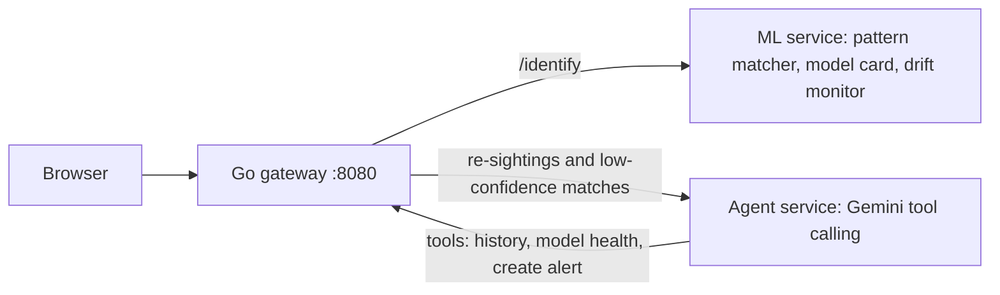

# WildID

[](https://github.com/hpowe2003/wildid/actions/workflows/ci.yml)
[](https://codespaces.new/hpowe2003/wildid)

Track individual animals by their coat patterns, with an LLM agent that triages suspicious sightings for a human reviewer.

Upload a photo of a spotted or striped animal. WildID fingerprints the pattern, matches it against known individuals, logs the sighting, and, for re-sightings and low-confidence matches, asks an AI agent to investigate and raise an alert.

## Quick start

You need [Docker](https://docs.docker.com/get-docker/) and a free [Gemini API key](https://aistudio.google.com/apikey). Without a key the app still runs; only the AI agent is disabled.

### Option 1: run the prebuilt images (fastest, no build)

```bash
mkdir wildid && cd wildid
curl -O https://raw.githubusercontent.com/hpowe2003/wildid/main/compose.quickstart.yml
echo "GEMINI_API_KEY=your-key-here" > .env
docker compose -f compose.quickstart.yml up -d
```

Open http://localhost:8080. Stop with `docker compose -f compose.quickstart.yml down` (add `-v` to erase data).

### Option 2: GitHub Codespaces (nothing to install)

Click the **Open in GitHub Codespaces** badge above. The app starts automatically and opens on port 8080. To enable the AI agent, add a Codespaces secret named `GEMINI_API_KEY` in your GitHub settings (Settings > Codespaces > Secrets) before creating the codespace.

### Option 3: build from source

```bash
git clone https://github.com/hpowe2003/wildid.git && cd wildid
cp .env.example .env        # then put your key in .env
docker compose up --build
```

## Try it in 2 minutes

The `samples/` folder has synthetic spotted-coat images (generated, not real animals).

1. Upload `cheetah_a.png` as species `cheetah` at the default location. It is logged as a **new animal** (CHE-001).
2. Upload `cheetah_a_variant.png` at the same location. It **matches CHE-001** at about 99%, and the agent files a low-priority alert.
3. Upload `cheetah_a_variant.png` again at latitude `-1.29`, longitude `36.82`. The agent sees an impossible travel speed and files a **high-priority alert**.
4. Upload `cheetah_b.png`. It is a different pattern, so it is logged as a **new animal** (CHE-002).
5. Use the **Ask the agent** box, for example: "Which animals were seen in more than one place?"

Alerts appear within about 15 seconds. Reset all data with `docker compose down -v`.

## How it works



| Service | Language | Role |
|---|---|---|
| `gateway` | Go | Web UI, REST API, upload validation, sighting and alert storage |
| `ml` | Python (FastAPI) | Coat-pattern fingerprinting, matching, model card, drift monitoring |
| `agent` | Python (FastAPI) | LLM agent with tools that investigates sightings and files alerts |

The agent can check an animal's sighting history (distance and implied speed between sightings), check model health, and file an alert. The question-answering path is read-only and cannot file alerts.

## Responsible AI

- A human makes every final identification decision; the agent only recommends.
- Matches near the threshold are flagged for review.
- A versioned model card and a drift monitor are exposed through the API and shown in the UI.
- Sighting text and tool output are treated as untrusted data by the agent, its tool loop is bounded, and alert creation requires a shared token.

## Configuration

Set these in `.env` (see `.env.example`).

| Variable | Default | Purpose |
|---|---|---|
| `GEMINI_API_KEY` | none | Enables the AI agent |
| `LLM_MODEL` | `gemini-3.8-flash` | Model name; Google retires old names, so update if you see a 404 |
| `LLM_BASE_URL` | Gemini OpenAI-compatible endpoint | Any OpenAI-compatible provider works |
| `AGENT_TOKEN` | `dev-token` | Shared secret for alert creation; change it for any shared deployment |

## API

| Method | Path | Description |
|---|---|---|
| POST | `/api/sightings` | Multipart: `species`, `lat`, `lon`, `file` (image, max 8 MB) |
| GET | `/api/sightings` | List sightings (`?individual_id=` to filter) |
| GET | `/api/alerts` | List agent alerts |
| POST | `/api/ask` | JSON `{"question": "..."}`, answered by the agent |
| GET | `/api/model` | Model card and gallery size |
| GET | `/api/monitor` | Drift flag, review rate, request count |
| GET | `/healthz` | Liveness check |

## Limitations

- The pattern matcher is a classical computer-vision baseline (a 128-number edge-orientation fingerprint), not a trained model. It is sensitive to pose, lighting and crop and has not been evaluated on real wildlife data. The LLM agent is the only machine-learning component.
- Storage is JSON files in Docker volumes, suitable for a demo and not for production.
- Free-tier Gemini limits apply, and the free tier may use prompts to improve Google's products. Do not submit sensitive data.

## Roadmap

- Replace the fingerprint with a pretrained re-identification embedding and evaluate it on a public wildlife dataset
- Postgres and a message bus in place of JSON files and direct calls
- Human confirm/reject buttons, with agent-versus-human agreement tracking
- Automated tests for the gateway and ML service

## Project structure

```
.github/workflows/ci.yml   build, check, and publish images to GHCR
.devcontainer/             one-click GitHub Codespaces setup
agent/                     LLM triage agent (Dockerfile, app.py)
gateway/                   Go API and web UI (Dockerfile, main.go, web/)
ml/                        pattern matcher service (Dockerfile, app.py)
samples/                   synthetic demo images
docker-compose.yml         build from source
compose.quickstart.yml     run prebuilt images
```

## Development

```bash
docker compose up --build          # rebuild after changes
cd gateway && go vet ./...         # Go checks
python -m compileall ml agent      # Python syntax check
```

Every push to `main` builds all three images and publishes them to `ghcr.io/hpowe2003/wildid/<service>:latest`.
